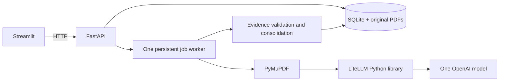

# AuditAuthor

AuditAuthor helps an auditor compare IT-control observations across AGO annual
reports. It extracts structured findings, verifies quoted evidence, groups specific
weaknesses across reports, and lets the auditor inspect source PDFs and export results.

## Run with Docker

From this directory:

```powershell
Copy-Item .env.example .env
# Edit .env: set OPENAI_API_KEY and AUDIT_MODEL=openai/<your-model-id>
docker compose up --build -d
```

Choose one OpenAI model available to your account that supports strict JSON-schema
structured outputs. The app deliberately has no silent default or fallback model.
The same configured model performs extraction and consolidation. Actual returned
model identifiers, prompt/schema versions and report hashes are retained with results.

Open **http://localhost:8501**. Backend OpenAPI documentation is at
**http://localhost:8000/docs**. Both ports bind to localhost. Credentials are passed
only to the backend. SQLite, originals and extracted text persist in `audit-data`.
`docker compose down` retains the volume; do not remove it if you need saved results.

Upload PDFs in the sidebar or import the supplied reports:

```powershell
docker compose exec backend auditauthor import /samples/ar_fy2021_22.pdf /samples/ar_fy2022_23.pdf /samples/ar_fy2023_24.pdf /samples/ar_fy2024_25.pdf
```

Select reports, start analysis, inspect coverage and errors, then review themes,
observations and source evidence. Every citation uses the **physical PDF page**,
which can differ from the printed page. Source PDFs are shown beside cited excerpts;
navigate to the indicated page using the viewer controls. CSV exports contain
findings; JSON exports also include insights, provenance and coverage.

For direct acquisition, select annual-report PDF links from the
[official AGO annual reports page](https://www.ago.gov.sg/publications/annual-reports), then run:

```powershell
docker compose exec backend auditauthor download "https://www.ago.gov.sg/<selected-report-path>.pdf"
```

The command accepts explicit HTTPS URLs on AGO's domains, validates every redirect,
enforces the upload limit, and records the source URL and content hash. It is not a
crawler; replace the example with an actual official PDF link. The provided files
have no verified download URL, so their provenance URL remains null.

## Stack and architecture



- FastAPI supplies typed HTTP contracts and the local job lifecycle.
- Streamlit provides a small review interface without a separate JavaScript stack.
- PyMuPDF retains digital text and physical page provenance.
- LiteLLM isolates provider transport and requests strict structured output.
- SQLite and a filesystem volume keep deployment to two containers.
- Pydantic validates requests, extraction and consolidation schemas.

See [architecture and functionality](docs/ARCHITECTURE.md),
[coding principles](AGENTS.md), [decisions](docs/DECISION_LOG.md),
[report inventory](docs/SAMPLE_REPORT_INVENTORY.md) and [task status](docs/TASKS.md).

## Solution and AI approach

Process all extractable text in overlapping character windows, retaining physical
page references and preceding-page context. Context includes headings as source
text; no heuristic assigns one agency to an entire page. This deliberately favors
coverage over keyword-only selection. No embeddings or retrieval layer is needed
for the four-report assessment corpus.

The extraction prompt separates actual weaknesses from good practices and reported
remediation. It requires nullable agency/system fields, a fixed IT-control taxonomy,
and exact source excerpts. Pydantic checks shape; deterministic validation checks
every quote against both the original page and the model's input. Unsupported
quotations are excluded and make the run partial. This does **not** automatically
prove the interpretation, agency attribution or stated risk is correct.

Consolidation runs by theme over validated observations. The model proposes specific
weakness groups and same-report duplicates; code validates references and boundaries,
prefers detailed findings and calculates distinct-report/agency counts. Recurrence
means the weakness appears in at least two distinct report hashes. Cross-agency
themes and repeated agency/system findings are shown separately. Evidence-backed
audit implications are suggestions for review, not established conclusions.

Requests have timeouts and bounded retries for transient errors or invalid structured
output. Jobs and successful chunks persist. A failed chunk can be retried without
rerunning completed chunks; dependent consolidation is recalculated when extraction
changes. A failed consolidation can be retried using saved extraction. Interrupted
jobs are marked on backend restart; queued jobs resume automatically.

## Local development and tests

Python 3.11+ and uv are required:

```powershell
uv sync --frozen
uv run uvicorn auditauthor.api.app:create_app --factory --port 8000
# In a second terminal:
uv run streamlit run src/auditauthor/ui/app.py
# Deterministic validation (no provider credentials required):
uv run pytest -q
uv run ruff check .
```

Do not run multiple Uvicorn workers or multiple backend containers against the same
data volume. Configure local settings in `.env`; environment variables override it.
Defaults: 20 MB/report, 500 pages/report, 20 reports/analysis, eight queued/running
jobs, 14,000-character windows with 2,000-character overlap, 120-second model timeout,
three request attempts. All are backend configuration except the request report cap.
Streamlit's default upload limit is also 20 MB; adjust its launch flag if increasing
the backend limit. Consolidation fails visibly above 160,000 characters for one
theme rather than silently truncating evidence.

## Continuous integration

The root [GitHub Actions workflow](../.github/workflows/ci.yml) runs on pull
requests, default-branch pushes and manual dispatch. Weekly security scans run
Mondays at 09:17 Singapore time. Feature-branch pushes without a pull request
create skipped runs; the default branch is detected from GitHub metadata.

- Python 3.11, uv 0.12.3 and locked dependencies; stale lockfiles fail setup.
- Ruff and unit/mocked integration tests; no live model calls or corpus PDFs.
- Bandit blocks medium/high severity issues and incomplete source scans.
- pip-audit checks locked runtime, development and security dependencies against
  the public PyPI advisory service. Findings appear in the Actions run summary and
  do not fail CI. Scanner failures and incomplete reports still fail.
- The free Gitleaks CLI scans all fetched Git history, with findings redacted.
  The CLI archive is checksum-pinned; no commercial Gitleaks Action is used.

Security tools are locked in the `security` dependency group. To reproduce checks:

```powershell
uv sync --locked --group security
uv run --frozen pytest tests/unit tests/integration -q
uv run --frozen ruff check .
uv run --frozen --group security bandit -r src -ll
uv export --frozen --all-groups --no-emit-project --output-file "$env:TEMP/audit-requirements.txt" --quiet
uv run --frozen --group security pip-audit --strict --disable-pip --no-deps -r "$env:TEMP/audit-requirements.txt"
```

Dependency advisories are visible in the Actions summary and do not block CI.
Scanner failures and incomplete reports still fail the security job.

## Evaluation

[EVALUATION_SET.json](docs/EVALUATION_SET.json) contains 25 source-grounded passage
cases with 32 expected observations and four negative passages. Labels are
**agent-reviewed candidates; independent human review remains pending**. Source
hashes and excerpts are checked by tests. Additional scenarios cover page boundaries,
agency changes, overview/detail repetition and FY2021/22 without keyword assumptions.

To run paid, explicit live evaluation after choosing the model:

```powershell
uv run python tests/evaluation/evaluate.py --live
# Independently review evaluation-results/review.json:
# assign matched_expected_id, judge semantically_supported, then set
# human_review_complete=true only after all cases are reviewed.
uv run python tests/evaluation/evaluate.py --score evaluation-results/review.json
```

Targets are finding precision >=90%, recall >=80%, and verified citations for every
accepted finding. Scoring counts duplicate predictions as false positives; rejected
citations do not count as accepted findings. Citation validity and semantic support
are reported separately. Passage-level scoring is not full-report recall or a
consolidation-quality measurement: review the integration scenarios and the complete
four-report run independently before claiming those capabilities are accurate.

## Assumptions, challenges and limitations

- Local single-auditor use, public digital-text PDFs, hosted OpenAI access and a
  bounded assessment corpus. No authentication, OCR, chat, vector database, reviewer
  edits, budget feature or production operations layer.
- Physical page numbers avoid malformed PDF labels and changing printed-page offsets.
- Overlap and preceding-page context reduce split findings but do not guarantee long
  distance agency attribution. Unknown attribution should remain null.
- Conservative exact deduplication plus model-proposed same-event deduplication
  reduces repetition, but semantic merging needs review. Entity counts use exact
  extracted names, so aliases may split counts.
- Image-dominant sparse pages are flagged for review; logos/dividers alone do not
  automatically trigger failure. Scanned-only reports are rejected. OCR needs a
  separate future design.
- Text extraction and mocked pipeline tests cannot establish live AI quality.
  No credentials/model were configured during implementation, so live accuracy is
  not claimed. See task status for actual checks.
- SQLite JSON aggregates keep the prototype readable but are unsuitable for large
  datasets or concurrent tenants. The single worker executes model requests serially.

Future improvements, after measuring actual failures: human-verified ground truth,
semantic support checks, better entity normalization and section segmentation,
OCR for scanned reports, larger-corpus consolidation and a production job system.

Implementation references: [LiteLLM structured JSON output](https://docs.litellm.ai/docs/completion/json_mode)
and [Streamlit PDF viewer](https://docs.streamlit.io/develop/api-reference/media/st.pdf).
