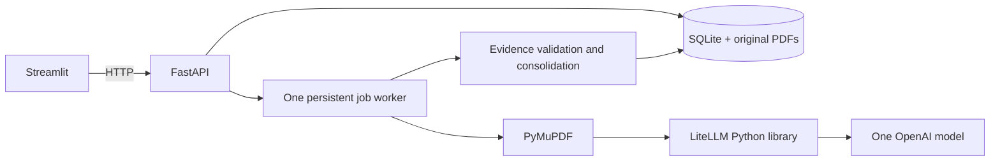

# AuditAuthor

AuditAuthor helps an auditor compare IT-control observations across AGO annual
reports. It extracts structured findings, verifies quoted evidence, groups specific
weaknesses across reports, and lets the auditor inspect source PDFs and export results.

## Run with Docker

From this directory:

```powershell
Copy-Item .env.example .env
# Edit .env: set OPENAI_API_KEY and AUDIT_MODEL=openai/<your-model-id>
docker compose up --build -d
```

Choose one OpenAI model available to your account that supports strict JSON-schema
structured outputs. The app deliberately has no silent default or fallback model.
The same configured model performs extraction and consolidation. Actual returned
model identifiers, prompt/schema versions and report hashes are retained with results.

Open **http://localhost:8501**. Backend OpenAPI documentation is at
**http://localhost:8000/docs**. Both ports bind to localhost. Credentials are passed
only to the backend. SQLite, originals and extracted text persist in `audit-data`.
`docker compose down` retains the volume; do not remove it if you need saved results.

Upload PDFs in the sidebar or import the supplied reports:

```powershell
docker compose exec backend auditauthor import /samples/ar_fy2021_22.pdf /samples/ar_fy2022_23.pdf /samples/ar_fy2023_24.pdf /samples/ar_fy2024_25.pdf
```

Select reports, start analysis, inspect coverage and errors, then review themes,
observations and source evidence. Every citation uses the **physical PDF page**,
which can differ from the printed page. Source PDFs are shown beside cited excerpts;
navigate to the indicated page using the viewer controls. CSV exports contain
findings; JSON exports also include insights, provenance and coverage.

For direct acquisition, select annual-report PDF links from the
[official AGO annual reports page](https://www.ago.gov.sg/publications/annual-reports), then run:

```powershell
docker compose exec backend auditauthor download "https://www.ago.gov.sg/<selected-report-path>.pdf"
```

The command accepts explicit HTTPS URLs on AGO's domains, validates every redirect,
enforces the upload limit, and records the source URL and content hash. It is not a
crawler; replace the example with an actual official PDF link. The provided files
have no verified download URL, so their provenance URL remains null.

## Stack and architecture



- FastAPI supplies typed HTTP contracts and the local job lifecycle.
- Streamlit provides a small review interface without a separate JavaScript stack.
- PyMuPDF retains digital text and physical page provenance.
- LiteLLM isolates provider transport and requests strict structured output.
- SQLite and a filesystem volume keep deployment to two containers.
- Pydantic validates requests, extraction and consolidation schemas.

See [architecture and functionality](docs/ARCHITECTURE.md),
[coding principles](AGENTS.md), [decisions](docs/DECISION_LOG.md),
[report inventory](docs/SAMPLE_REPORT_INVENTORY.md) and [task status](docs/TASKS.md).


## Local development and tests

Python 3.11+ and uv are required:

```powershell
uv sync --frozen
uv run uvicorn auditauthor.api.app:create_app --factory --port 8000
# In a second terminal:
uv run streamlit run src/auditauthor/ui/app.py
# Deterministic validation (no provider credentials required):
uv run pytest -q
uv run ruff check .
```

Configure local settings in `.env`; environment variables override it.
Defaults: 20 MB/report, 500 pages/report, 20 reports/analysis, eight queued/running
jobs, 14,000-character windows with 2,000-character overlap, 120-second model timeout,
three request attempts. All are backend configuration except the request report cap.
Streamlit's default upload limit is also 20 MB; adjust its launch flag if increasing
the backend limit. Consolidation fails visibly above 160,000 characters for one
theme rather than silently truncating evidence.

## Continuous integration

The root [GitHub Actions workflow](.github/workflows/ci.yml) runs on pull
requests, default-branch pushes and manual dispatch. Feature-branch pushes without a pull request
create skipped runs; the default branch is detected from GitHub metadata.

- Python 3.11, uv 0.12.3 and locked dependencies; stale lockfiles fail setup.
- Ruff and unit/mocked integration tests; no live model calls or corpus PDFs.
- Bandit blocks medium/high severity issues and incomplete source scans.
- pip-audit checks locked runtime, development and security dependencies against
  the public PyPI advisory service. Findings appear in the Actions run summary and
  do not fail CI. Scanner failures and incomplete reports still fail.
- The free Gitleaks CLI scans all fetched Git history, with findings redacted.
  The CLI archive is checksum-pinned; no commercial Gitleaks Action is used.

Security tools are locked in the `security` dependency group. To reproduce checks:

```powershell
uv sync --locked --group security
uv run --frozen pytest tests/unit tests/integration -q
uv run --frozen ruff check .
uv run --frozen --group security bandit -r src -ll
uv export --frozen --all-groups --no-emit-project --output-file "$env:TEMP/audit-requirements.txt" --quiet
uv run --frozen --group security pip-audit --strict --disable-pip --no-deps -r "$env:TEMP/audit-requirements.txt"
```

Dependency advisories are visible in the Actions summary and do not block CI.
Scanner failures and incomplete reports still fail the security job.

## Solution and AI approach

AuditAuthor uses AI to read and organize report text, while ordinary Python code
controls file identity, page references, validation, counting and job state:

```text
PDF -> PyMuPDF page text -> overlapping chunks -> AI extraction
    -> exact evidence checks -> duplicate removal -> AI consolidation
    -> Python-calculated recurrence and review insights
```

PyMuPDF stores digital text with one-based physical PDF page numbers. Reports are
split into overlapping character windows, including the preceding page tail as
context. This supports findings that cross chunk boundaries and considers all
extractable text rather than relying on keywords. Image-dominant pages are flagged;
scanned-only PDFs are rejected because OCR is not part of v1.

Each chunk is sent through LiteLLM to the configured model with a versioned prompt
and strict Pydantic JSON schema. The model identifies actual IT-control weaknesses,
including technology issues outside an ``IT`` heading, and returns a theme, weakness,
optional agency/system, optional reported risk/remediation, and literal page
excerpts. It must use ``null`` for unsupported facts and cannot invent severity,
impact, recurrence or resolution status. Timeouts and bounded retries handle
transient provider failures; model, prompt and schema provenance is retained.

Application code verifies every excerpt against both the stated physical PDF page
and the chunk supplied to the model (normalizing whitespace only). Invalid quotes
are rejected, while valid observations remain reviewable. This proves quotation
integrity, not semantic correctness or attribution, which still require auditor
review. Overlapping chunks are deduplicated only when report, agency, system, theme,
title and evidence match, so distinct sub-findings are preserved.

Validated findings are grouped by theme and sent to a second consolidation prompt.
The model proposes specific same-weakness groups and cautious audit implications.
Python validates all referenced IDs, prevents duplicate groups crossing report or
agency/system boundaries, and requires every finding to be covered. Python also
calculates report and agency counts. A weakness is recurrent only when it appears
in at least two distinct report hashes; the model cannot set this value.

Analysis is a persisted single-worker job. Successful chunks are saved immediately,
retries reuse them, and changed extraction invalidates dependent consolidation.
Failures, page warnings and incomplete coverage are surfaced as partial results.
Exports include findings, insights, coverage and provenance. Mocked tests validate
the pipeline mechanics, while live model quality and semantic correctness require
separate benchmark and human evaluation.

## Assumptions
- All text within PDF can be extracted via PyMuPDF and does not require OCR to process. No important information are embedded in images.
- All PDF are relatively similar in terms of format.

## Challenges
- Chunk size and overlapping size decisions
- Overlap and preceding-page context reduce split findings but cannot guarantee
  agency attribution across distant pages
- LLM parsing and extracted insights quality and accuracy
- SQLite JSON aggregates keep the prototype readable but are unsuitable for large
  datasets or concurrent tenants. The single worker executes model requests serially.

## Improvements
### Model Evaluation
Require evaluation of model effectiveness in extraction, consolidation and creation of audit insights. It should include accuracy and comprehensiveness of observations extracted. LLM-As-A-Judge with ground truths, or human evaluation can be used in this step.

### Comprehensive LLM Gateway
LLM gateway currently only supports OpenAI models. A proper LLM gateway implementation allows for model agnostic implmentation and less maintenance.

### Indexing and Vector Database Improvement
Using an embedding model to embed chunks into vector database instead of using SQLite. This allows for further insights to be supported if auditors require, via Retrieval Augemented Generation (RAG), and vastly speeds up retrieval due to vector search.
